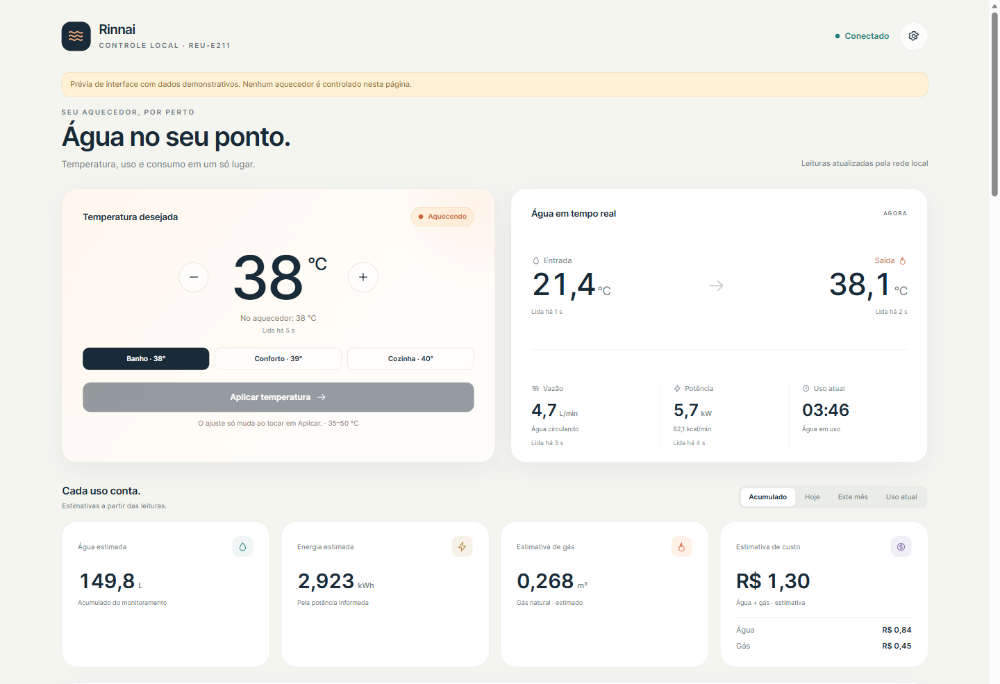
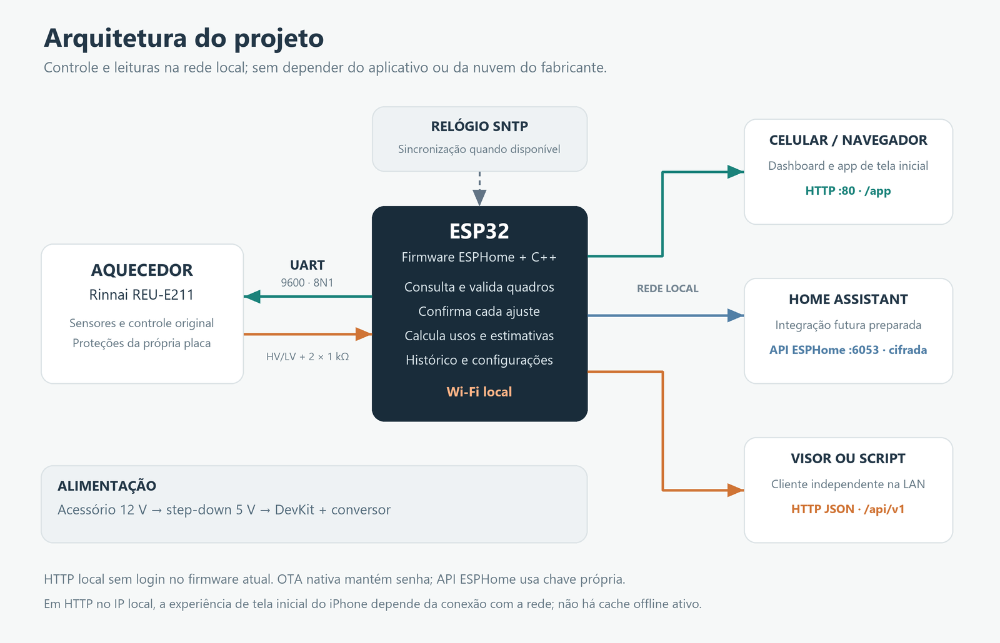
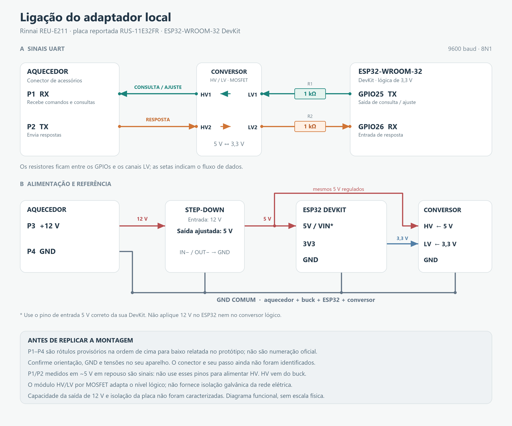
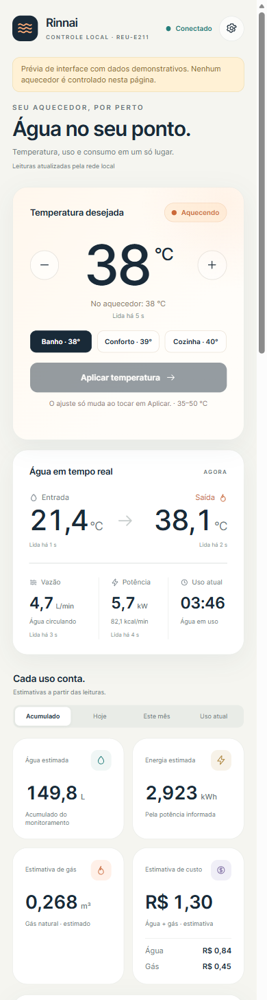
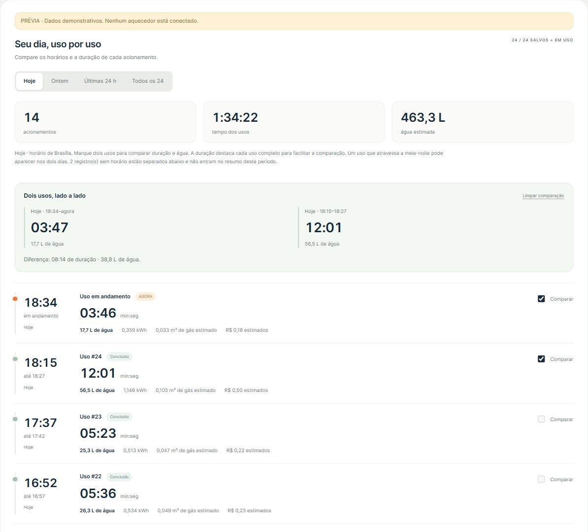

# Rinnai Local — ESP32, painel web e Home Assistant

Controle e monitoramento local de um aquecedor **Rinnai REU-E211** usando um **ESP32-WROOM-32**, sem o módulo Wi-Fi original e sem depender do aplicativo do fabricante.

O ESP consulta a interface serial do aquecedor, apresenta um painel responsivo, registra os usos e disponibiliza uma **API HTTP em JSON** e a **API nativa do ESPHome**. O painel funciona sozinho; Home Assistant é opcional.

**Firmware de referência: 1.2.0 · ESPHome: 2026.6.5 · UART: 9600 8N1 · Wi-Fi: 2,4 GHz**

**Licença: [MIT](LICENSE) · © 2026 Lucas Turchet**



*As imagens do painel usam dados demonstrativos, sem informações de uma instalação real.*

> Projeto independente, sem vínculo ou certificação da Rinnai. A validação refere-se ao protótipo descrito aqui. A montagem envolve a eletrônica de um equipamento a gás e deve ser executada por pessoa capacitada, com o aparelho desenergizado durante alterações de fiação. O firmware não substitui o controle nem as proteções originais do aquecedor.

## Índice

- [Recursos](#recursos)
- [Compatibilidade e estado do projeto](#compatibilidade-e-estado-do-projeto)
- [Arquitetura](#arquitetura)
- [BOM — lista de materiais](#bom--lista-de-materiais)
- [Diagrama e conexões](#diagrama-e-conexões)
- [Preparação e primeira gravação](#preparação-e-primeira-gravação)
- [Wi-Fi e primeiro acesso](#wi-fi-e-primeiro-acesso)
- [Atualização OTA](#atualização-ota)
- [Painel, histórico e estimativas](#painel-histórico-e-estimativas)
- [Instalar no iPhone](#instalar-no-iphone)
- [API HTTP](#api-http)
- [Home Assistant](#home-assistant)
- [Protocolo serial](#protocolo-serial)
- [Desenvolvimento e testes](#desenvolvimento-e-testes)
- [Diagnóstico e solução de problemas](#diagnóstico-e-solução-de-problemas)
- [Licença e marcas](#licença-e-marcas)
- [Referências](#referências)

## Recursos

| Área | Implementado |
|---|---|
| Controle | Alvo entre **35 e 50 °C**, com leitura física antes/depois dos passos de ajuste |
| Leituras | Entrada, saída, vazão, potência informada, chama, temperatura ajustada e código de erro |
| Painel | Responsivo, assets locais, três favoritos editáveis e atualização periódica |
| Consumos | Água, energia, estimativa de GN/GLP, tempo aquecendo e quantidade de usos |
| Custos | **Água, gás e total separados**, com tarifas configuráveis |
| Visão diária | Hoje, Ontem, Últimas 24 h e Todos os 24; comparação entre dois usos |
| Histórico | Até **24 usos concluídos persistidos**, com horários disponíveis e indicadores de cobertura |
| Gráficos | Até **24 horas**, 720 pontos de dois minutos, mantidos em RAM |
| Resumos | Até **31 dias e 12 meses**, persistidos na flash |
| Exportação | CSV de usos, gráficos e períodos; diagnóstico em TXT |
| Avisos | Uso prolongado, fluxo contínuo, erro e perda de comunicação, enquanto o painel está aberto |
| Diagnóstico | Memória, comunicação, armazenamento, inicializações e registro da última falha disponível |
| Integrações | API HTTP v1/OpenAPI e API nativa ESPHome criptografada |
| Arquivo no Home Assistant | Integração opcional Rinnai Local: IDs duráveis, recuperação do buffer, calendário e consulta paginada de usos |
| Celular | Ícone na tela inicial e abertura como aplicativo no iPhone |
| Manutenção | Primeira gravação por USB; atualizações posteriores por Wi-Fi |

Não estão implementados: ligar/desligar o aquecedor, acionar ignição, alterar proteções, comandos seriais arbitrários, notificações push ou acesso por nuvem.

## Compatibilidade e estado do projeto

| Item | Referência validada / limite |
|---|---|
| Aquecedor | **REU-E211**, modelo informado no protótipo |
| Marcação da placa | **RUS-11E32FR**, informada na placa utilizada; não é uma tabela oficial de compatibilidade |
| Combustível ensaiado | **GN**; o cálculo também oferece GLP, sem ensaio físico com GLP neste projeto |
| Microcontrolador | **ESP32 clássico / WROOM-32 DevKit**, flash de 4 MB, `board: esp32dev`, framework ESP-IDF |
| GPIOs | **GPIO25** para transmitir consultas/ajustes; **GPIO26** para receber respostas |
| Outros ESP32 | **C3 e S3 não são substituições diretas.** O transporte usa recursos específicos do ESP32 clássico e GPIOs fixos; exige portabilidade do código |
| Conversor lógico | Módulo comum HV/LV por MOSFET, com dois canais utilizados; componente exato não identificado |
| Home Assistant | Entidades e ação nativa disponíveis; a integração com um servidor HA é uma etapa opcional do usuário |

O [manual oficial do acessório ROU003/ROU0031](https://www.rinnai.com.br/uploads/manual/203.pdf) lista o **REU-E211FEH** e indica o ponto serial B. Essa referência ajuda a localizar a interface do acessório; não confirma por si só a pinagem de todas as revisões nem a compatibilidade deste firmware com outros aparelhos.

No protótipo foram verificadas respostas dos oito registradores, variação das leituras com água quente e ajuste físico **38 → 39 → 38 °C**. Na versão 1.1.0 também foram verificados OTA, API JSON, preservação de configurações/histórico e comando com o mesmo alvo, sem passos relativos adicionais.

## Arquitetura



[Abrir arquitetura em SVG](docs/images/architecture.svg)

O ESP envia consultas: a escuta passiva não produziu telemetria no aparelho testado. O ciclo de fundo consulta um dos oito registradores por segundo, nominalmente um ciclo completo a cada oito segundos. Um ajuste de temperatura pausa esse ciclo para executar sua própria sequência de confirmação.

O navegador recebe o estado do ESP pela rede local; não acessa a UART diretamente. Os horários usam SNTP, com apresentação de dias/períodos em Brasília. A operação de leitura e controle não depende da nuvem do fabricante; para datar usos e períodos é necessário um relógio sincronizado.

## BOM — lista de materiais

| Ref. | Qtd. | Material | Critério de escolha |
|---|---:|---|---|
| U1 | 1 | ESP32-WROOM-32 DevKit | ESP32 clássico, GPIO25/26 acessíveis e entrada de alimentação de 5 V identificada |
| U2 | 1 | Conversor lógico HV/LV por MOSFET | 5 V ↔ 3,3 V, ao menos dois canais; módulo comum tipo BSS138, sem confirmação do componente instalado |
| U3 | 1 | Step-down DC-DC | Entrada compatível com aproximadamente 12 V, saída ajustável/regulada em **5 V** |
| R1/R2 | 2 | Resistor **1 kΩ** | Em série, um por GPIO, no lado LV; 1/4 W é uma escolha prática |
| J1 | 1 | Conector de quatro vias com terminais | Conferir encaixe, passo e orientação no aparelho; **modelo exato ainda não identificado** |
| — | 1 conjunto | Fios, termorretrátil e fixadores | Conexões firmes, isoladas e com alívio de esforço |
| — | 1 | Placa de montagem / PCB | Para fixar módulos e resistores |
| — | 1 | Caixa / suporte | Compatível com espaço, temperatura e proteção contra contato/água |
| — | 1 | Cabo USB de dados | Gravação inicial e bancada |

Para o buck, uma saída nominal de **5 V / pelo menos 1 A** dá folga na seleção do regulador. Isso **não é o consumo medido** nem significa que o aquecedor forneça 1 A: a capacidade de corrente da sua saída de acessórios não foi caracterizada neste projeto.

Ferramentas: multímetro, ferramentas de montagem e, para investigar outra placa ou sinais, osciloscópio/analisador lógico. Não há orçamento fechado em R$: a BOM evita atribuir preços ou modelos comerciais que não foram conferidos.

Veja [hardware e BOM detalhados](docs/HARDWARE.md).

## Diagrama e conexões



[Abrir diagrama vetorial em SVG](docs/images/wiring-diagram.svg)

### Identificação do conector do aquecedor

**P1, P2, P3 e P4 são nomes provisórios deste projeto**, seguindo a ordem de cima para baixo relatada no protótipo. Não há foto que fixe a orientação de observação nem numeração oficial confirmada. O desenho é funcional: não o use como orientação mecânica de encaixe sem identificar os pinos no seu aparelho.

| Rótulo | Medição DC relativa a GND | Função confirmada / observada |
|---|---:|---|
| P1 | Aproximadamente 5 V em repouso | **RX do aquecedor**, recebe o ESP |
| P2 | Aproximadamente 5 V em repouso | **TX do aquecedor**, envia ao ESP |
| P3 | Aproximadamente 12 V | Alimentação de acessórios utilizada na montagem |
| P4 | 0 V | GND de referência da montagem |

As direções de P1/P2 foram confirmadas por transações seriais válidas. A medição DC, sozinha, não identifica direção, amplitude dos pulsos ou topologia elétrica. **P1 e P2 são sinais; não use essas linhas como alimentação de 5 V.**

### Sinais UART

| ESP32 / origem | Caminho completo | Aquecedor / destino |
|---|---|---|
| **GPIO25 — TX** | GPIO25 → **R1 1 kΩ** → **LV1** → canal 1 → **HV1** | **P1 — RX** |
| **GPIO26 — RX** | GPIO26 ← **R2 1 kΩ** ← **LV2** ← canal 2 ← **HV2** | **P2 — TX** |

`GPIO25` é o número do GPIO, não a posição física 25 no conector da DevKit. No conversor, mantenha o par correspondente LV1/HV1 e LV2/HV2. A taxa é **9600 baud, 8N1, sem inversão no ESP**.

O transporte deste projeto transmite temporariamente em **open-drain** no GPIO25: nível alto libera a linha; ao terminar o quadro, o pino volta à recepção. Essa escolha faz parte da montagem validada, não é uma recomendação genérica para qualquer UART push-pull ou conversor HV/LV.

### Alimentação

| Origem | Destino |
|---|---|
| P3 — aproximadamente 12 V | Buck **IN+** |
| P4 — GND | Buck **IN−** |
| Buck **OUT+**, medido e ajustado em **5 V** | Entrada de **5 V correta da DevKit** e **HV** do conversor lógico |
| ESP32 **3V3** | **LV** do conversor lógico |
| P4, buck IN−/OUT−, ESP32 GND e conversor GND | **GND comum** |

Meça o buck antes de conectá-lo ao ESP. A inscrição `VIN` varia entre DevKits: este esquema usa **5 V na entrada adequada da placa**, nunca 12 V direto no ESP nem 5 V em GPIO. Na primeira gravação, use USB com o conjunto desconectado do aquecedor; evite USB e buck alimentando simultaneamente sem verificar o circuito de alimentação da sua DevKit.

Conversor MOSFET e buck comum **não fornecem isolação galvânica**. A isolação do GND da placa do aquecedor em relação à rede elétrica não foi verificada; não presuma que esse GND seja terra de proteção ou referência segura para instrumentos aterrados.

## Preparação e primeira gravação

### 1. Ambiente

Use **Python 3.11–3.14**, Node.js com `node` no PATH e cabo USB de dados. O Node é usado para validar o service worker durante a geração dos assets; o ESP não executa Node nem Python.

Abra um terminal na raiz do repositório. Crie e ative um ambiente virtual:

**Windows / PowerShell**

```powershell
python -m venv .venv
.\.venv\Scripts\Activate.ps1
python -m pip install --upgrade pip
python -m pip install -r requirements.txt
node --version
```

Se a ativação do PowerShell estiver bloqueada, use `.\.venv\Scripts\python.exe` no lugar de `python` nos comandos, sem alterar a política do sistema.

**Linux / macOS**

```bash
python3 -m venv .venv
source .venv/bin/activate
python -m pip install --upgrade pip
python -m pip install -r requirements.txt
node --version
```

A versão **2026.6.5 do ESPHome** está fixada porque o código usa detalhes do adaptador web ESP-IDF e das UARTs. Versões diferentes precisam de revisão; não há promessa de compatibilidade com qualquer atualização do ESPHome.

### 2. Credenciais exclusivas e configuração local

```sh
python analysis/create_secrets.py
```

O comando cria `esphome/secrets.yaml` com credenciais aleatórias e **recusa sobrescrever um arquivo existente**. Consulte esse arquivo localmente para obter a senha do AP, chave da API nativa e senha OTA. Ele não contém o Wi-Fi da casa: a rede pode ser provisionada no portal do ESP.

Como alternativa manual, copie [secrets.example.yaml](esphome/secrets.example.yaml) para `secrets.yaml` e substitua todos os valores. A chave da API nativa deve representar 32 bytes em Base64. `web_username` e `web_password` existem por herança do YAML base; o firmware smart remove o login HTTP.

Crie a configuração da sua instalação:

```powershell
# Windows
Copy-Item esphome/rinnai-install.example.yaml esphome/rinnai-local.yaml
```

```bash
# Linux / macOS
cp esphome/rinnai-install.example.yaml esphome/rinnai-local.yaml
```

O [exemplo de instalação](esphome/rinnai-install.example.yaml) inclui `rinnai-smart-wroom32.yaml` e usa `RESTORE_DEFAULT_ON` para a leitura automática. Isso é importante em uma **NVS nova**: a configuração de investigação herdada usa padrão OFF. O override altera o padrão quando não existe preferência salva; se OFF já estiver persistido, ative o switch **Leitura automatica do aquecedor** pela API nativa ESPHome.

### 3. Gerar assets, validar e compilar

```sh
python analysis/embed_pwa_assets.py
python analysis/embed_api_assets.py
python -m esphome config esphome/rinnai-local.yaml
python -m esphome compile esphome/rinnai-local.yaml
```

O primeiro comando gera ícones, manifest e service worker, executa as verificações locais e embute os assets em flash. O segundo valida/embute a documentação da API. **Repita ambos antes de compilar após mudanças na interface ou documentação.**

O comando `config` pode exibir informações da configuração expandida; não publique essa saída sem revisão. A primeira compilação baixa o toolchain e as dependências do ESP-IDF.

### 4. Gravar por USB

Mantenha o ESP desconectado do aquecedor e use o cabo USB de dados. Escolha a porta correta:

```powershell
# Exemplo Windows: substitua COM5 pela porta da sua placa.
python -m esphome upload esphome/rinnai-local.yaml --device COM5
```

```bash
# Exemplo Linux: substitua pela porta da sua placa.
python -m esphome upload esphome/rinnai-local.yaml --device /dev/ttyUSB0
```

No macOS a porta costuma aparecer como `/dev/cu.*`; use a que corresponde à DevKit. Se necessário, entre no modo de gravação usando o botão BOOT conforme sua placa.

O nome de dispositivo herdado é **`rinnai-sniffer`**. Apesar do nome histórico, o exemplo acima compila o firmware smart com controle e painel completos. Não troque o `board` para C3/S3 esperando portabilidade automática.

## Wi-Fi e primeiro acesso

1. Na primeira inicialização, aguarde a rede de configuração **Rinnai Sniffer**.
2. Conecte usando `sniffer_ap_password`, do seu arquivo `secrets.yaml`.
3. Abra o portal cativo ou acesse **`http://192.168.4.1`**.
4. Escolha a rede Wi-Fi **2,4 GHz** e informe sua senha.
5. Descubra o IP atribuído pelo roteador. O nome **`rinnai-sniffer.local`** também pode funcionar se sua rede suportar mDNS.
6. Abra `http://IP_DO_ESP/` ou `http://IP_DO_ESP/app`.

Depois da gravação e configuração em bancada, desligue o conjunto, faça as conexões conferidas no diagrama e religue. As leituras passam a aparecer após as consultas ao aquecedor. O módulo também oferece AP de recuperação quando não consegue se conectar à rede configurada.

**`192.168.1.50` é apenas o IP ilustrativo usado nos comandos a seguir.** Substitua pelo endereço do seu ESP. Uma reserva DHCP no roteador facilita os acessos e as integrações.

## Atualização OTA

Após a primeira gravação, o computador e o ESP precisam ter conectividade entre si. Preserve o `secrets.yaml` da instalação: a senha OTA deve corresponder à que está no dispositivo.

```sh
python analysis/embed_pwa_assets.py
python analysis/embed_api_assets.py
python -m esphome compile esphome/rinnai-local.yaml
python -m esphome upload esphome/rinnai-local.yaml --device 192.168.1.50
```

A atualização usa a OTA nativa com senha, na porta **3232**. Não há formulário de upload de firmware no painel web. Após o envio, mantenha a alimentação e aguarde pelo menos **75 segundos** antes de solicitar outro reinício, respeitando a confirmação de boot.

Compile sempre a configuração desejada imediatamente antes do upload: as variantes herdadas compartilham nome/pasta de build. A imagem `firmware.factory.bin` é combinada para gravação inicial; `firmware.ota.bin` é a imagem de atualização. Usando o CLI acima, o ESPHome seleciona o fluxo apropriado.

Tarifas, preferências, acumulados, períodos e usos concluídos sobrevivem à OTA normal. Os pontos do gráfico em RAM reiniciam. Apagar a flash/NVS não equivale a OTA e remove dados/configurações.

## Painel, histórico e estimativas

### Controle e favoritos

Selecione o alvo ou um dos três favoritos e toque em **Aplicar temperatura**. Selecionar um favorito na interface não envia o comando imediatamente. O painel mostra a temperatura confirmada no aquecedor e o andamento do ajuste.

O controlador aceita alvos inteiros entre 35 e 50 °C. Os comandos físicos são relativos, mas o firmware os envolve em consultas: confirma o estado, executa um passo e consulta novamente. Timeout/resposta incerta interrompe o pedido sem repetição cega.



### Dados persistidos e voláteis

| Informação | Capacidade | Sobrevive ao reinício? |
|---|---:|---|
| Usos concluídos | **24 registros** mais recentes | Sim |
| Totais de água, energia, tempo e usos | Acumulado do acompanhamento | Sim, até a última gravação |
| Resumos diários / mensais | **31 dias / 12 meses** | Sim |
| Tarifas, favoritos e avisos | Configuração atual | Sim |
| Histórico de inicializações | **12 registros** | Sim |
| Registro da última falha disponível | Até **2048 bytes**, associado ao firmware | Sim, quando capturado/persistido |
| Gráfico | **720 pontos × 120 s**, até 24 h | **Não: RAM** |
| Último comando HTTP acompanhado | Um comando por boot | Não |
| Arquivo opcional Rinnai Local no HA | 10.000 usos por padrão, até 50.000 configuráveis | Sim, no armazenamento do HA; independente do buffer de 24 do ESP |

**24 usos não significam cobertura garantida de um dia inteiro**: se houver mais acionamentos, o anel descarta os mais antigos. O gráfico também começa no boot, sem recuperar pontos anteriores.

Os usos guardam início/fim quando há relógio confiável. Registros migrados podem ter início desconhecido. O **tempo transcorrido** e o **tempo acompanhado com leituras válidas** são apresentados separadamente; uma lacuna não é preenchida como se houvesse dados. Os horários de abertura/fechamento são observados na cadência das consultas, não medidos com precisão de evento físico.



O painel permite comparar dois acionamentos. Não identifica automaticamente qual pessoa tomou banho nem distingue por conta própria banho de torneira.

Totais/usos são gravados ao fim do uso e, havendo alterações, periodicamente a cada dez minutos; há também tentativa de gravação no desligamento controlado. Falta abrupta de energia pode perder a parcela posterior à última gravação. A atualização visual do painel não grava a flash a cada segundo.

### Como o custo é calculado

As estimativas usam as leituras do aquecedor e o tempo efetivamente acompanhado:

```text
água [L]          = integral da vazão [L/min] no tempo válido
energia [kWh]     = integral da potência informada no tempo válido
energia [kcal]    = energia [kWh] × 3600 / 4,1868
GN estimado [m³]  = energia [kcal] / 9400
GLP estimado [kg] = energia [kcal] / 11500
custo da água    = água [L] / 1000 × tarifa de água [R$/m³]
custo do gás     = gás estimado × tarifa [R$/m³ GN ou R$/kg GLP]
```

Configure as tarifas na engrenagem. A tarifa da água pode incluir esgoto, se desejar. **Zero na configuração significa tarifa não informada**: sua parcela aparece em aberto, não como consumo gratuito. Com uma única tarifa, o total soma apenas a parcela disponível e é identificado como incompleto.

O sistema não possui medidor físico de gás, não foi aferido contra instrumentos externos e não aplica um modelo de rendimento/calibração para transformar a estimativa em medição de concessionária. Alterar a tarifa reavalia os registros disponíveis pelo valor atual; não existe livro de tarifas históricas. Não há reconstrução do consumo anterior ao acompanhamento.

Nos gráficos, cada intervalo de dois minutos conserva picos de vazão/potência, chama observada e últimas temperaturas válidas. Esses pontos servem à visualização e não substituem as amostras usadas na integração dos consumos.

## Instalar no iPhone

1. Abra **`http://IP_DO_ESP/app` no Safari**.
2. Toque em **Compartilhar**.
3. Escolha **Adicionar à Tela de Início**.
4. Use o nome **Aquecedor** e mantenha **Abrir como App** ativado, se essa opção aparecer.
5. Abra pelo novo ícone da tela inicial.

O painel inclui manifest, ícone Apple e modo standalone. No endereço **HTTP da rede local**, a abertura como aplicativo depende de conexão para carregar o painel: **service worker/cache offline não ficam ativos nesse contexto**. O service worker é registrado somente em contexto seguro, como HTTPS/localhost; mesmo ali, dados e comandos da API não são armazenados nem enfileirados para execução posterior.

O projeto não configura HTTPS público, proxy externo nem notificações push. Após uma atualização, recarregue o painel para carregar os novos assets.

## API HTTP

Base: `http://IP_DO_ESP/api/v1`. Documentação embarcada em **`/api/docs`** e contrato importável em **`/api/openapi.json`**. A versão do contrato (**v1**) é independente da versão do firmware.

| Método | Caminho após `/api/v1` | Finalidade |
|---|---|---|
| GET | `/` ou `/capabilities` | Recursos, limites, unidades e intervalos sugeridos |
| GET | `/state` | Estado completo, consumos, configurações e avisos |
| GET | `/telemetry` | Leituras e sua atualidade, para scripts/visores |
| GET | `/settings` | Tarifas, favoritos e avisos |
| GET | `/control` | Acompanhamento do último comando HTTP de temperatura |
| GET | `/history` | Gráfico e usos concluídos |
| GET | `/sessions` | Desde 1.2.0: usos de um checkpoint durável, com IDs estáveis para sincronização |
| GET | `/periods` | Resumos diários e mensais |
| GET | `/diagnostics` | Memória, inicializações, falha e armazenamento |
| GET | `/health` | Saúde: 200 disponível; 503 inicial/degradado |
| POST | `/temperature` | Solicitar alvo absoluto: `{"target":38}` |
| POST | `/favorite` | Aplicar favorito imediatamente: `{"slot":1}` |
| POST | `/settings` | Substituir tipo de gás e duas tarifas |
| POST | `/preferences` | Substituir os três favoritos e todos os avisos |
| POST | `/control/cancel` | Impedir novos passos de um ajuste: `{}` |
| POST | `/device/restart` | Reiniciar **somente o ESP**, com `{"confirm":true}` |

Exemplos `curl` em shell compatível:

```bash
curl --fail http://192.168.1.50/api/v1/telemetry

# Este POST realmente solicita uma temperatura; escolha o alvo desejado.
curl --fail -X POST http://192.168.1.50/api/v1/temperature \
  -H 'Content-Type: application/json' -d '{"target":38}'

curl --fail http://192.168.1.50/api/v1/control
```

POST exige JSON, campos conhecidos e corpo de até **2048 bytes**. **202 significa enfileirado**, não confirmação física: acompanhe `/control`, correlacionando `boot_id` + `command_id`, até `confirmed`, `failed` ou `cancelled`. Só há uma vaga de controle; concorrência retorna 409. Após resposta perdida, consulte o estado antes de decidir por novo pedido.

Consulte `/telemetry` a cada **2 s** e histórico/períodos/diagnósticos a cada **10 s ou mais**. `null` significa desconhecido; utilize `online`, `readings.*.stale` e `age_s` para apresentar valores atuais. As leituras dos registradores não são simultâneas.

O painel e a API HTTP estão **sem autenticação**, para uso na rede local. Há validação de origem no navegador, mas isso não equivale a autenticação e não protege contra outros clientes na rede. API nativa e OTA mantêm credenciais próprias. Não publique esse HTTP diretamente na Internet.

Detalhes de todos os corpos JSON, unidades, erros, cancelamento, limites de reinício e exemplos Python/PowerShell: **[guia completo da API](esphome/API_LOCAL.md)** · **[OpenAPI](esphome/api/openapi.json)**.

## Home Assistant

O controle e a telemetria usam a [integração ESPHome](https://www.home-assistant.io/integrations/esphome/), pela API nativa criptografada na porta **6053**. Para o arquivo por banho/acionamento, o firmware 1.2.0 acrescenta a integração opcional **Rinnai Local**, incluída neste repositório. O painel web continua funcionando independentemente delas.

1. Em Home Assistant, abra **Configurações → Dispositivos e serviços → Adicionar integração → ESPHome**.
2. Informe o IP/hostname do ESP e a porta 6053.
3. Informe a chave `api_encryption_key` da sua instalação quando solicitada.
4. Confira sensores, conectividade e a entidade **Temperatura ajustada**.

São publicados temperaturas, vazão, potência, chama, erro, estado do controle, água/energia/gás acumulados estimados, custo total, tempo aquecendo, quantidade de usos e duração do uso atual. A entidade de GLP fica sem valor quando GN está selecionado. A ação nativa **`ajustar_temperatura(target)`** usa o mesmo controlador de confirmação.

Os nomes finais de entidades/ações dependem do cadastro no HA; não há IDs de entidade fixos para copiar. Um visor independente pode usar a API HTTP `/telemetry`, sem instalar Home Assistant nem o aplicativo do fabricante.

**Histórico por acionamento:** copie `home_assistant/custom_components/rinnai_local` para `/config/custom_components/rinnai_local`, reinicie o HA e adicione **Rinnai Local** informando a URL HTTP do ESP. A integração consulta `/sessions` a cada dez segundos e mantém seu arquivo persistente no HA, com calendário somente leitura, sensores do último uso/contagens/diagnóstico e a ação paginada `rinnai_local.get_history`. Não requer MQTT.

Os IDs permanecem estáveis em reinícios/OTA e não dependem do relógio. A integração importa os usos ainda disponíveis, evita duplicações, confirma a gravação antes de avançar o cursor e sinaliza falhas/lacunas. A recuperação fica limitada aos **24 registros do buffer do ESP**; os usos já arquivados no HA são conservados além dessa janela, até o limite configurado de **10.000 por padrão / 50.000 no máximo**, sem exclusão silenciosa ao atingir o limite.

Usos sem horário confiável continuam no arquivo/consulta paginada, mas não recebem eventos de calendário em horários inventados. Os custos são congelados com a base de preço da primeira importação; alteração posterior de tarifa não reprecifica silenciosamente o passado. Detalhes, limites e instalação: **[guia Home Assistant](home_assistant/README.md)**.

## Protocolo serial

O protocolo foi investigado a partir do aplicativo/firmware do acessório e depois validado por consultas ao aparelho. Este repositório distribui a implementação própria e documentação; **não é necessário obter, instalar ou executar o APK para compilar ou usar o projeto**.

| Parâmetro | Valor |
|---|---|
| UART | **9600 baud, 8N1**, sem inversão no ESP |
| Consulta | Quadro de 12 bytes, comando binário `F6`, endereço ASCII e quantidade ASCII `02` |
| Resposta de leitura | Quadro correlacionado de 16 bytes, com checksum e dados ASCII hexadecimais |
| Validação | Enquadramento, comprimento, checksum e correspondência com consulta pendente |
| Janela de resposta | 500 ms |
| Controle | Quadros fixos de incremento/decremento; consultas antes/depois de cada passo |

| Registrador | Uso | Conversão / limite |
|---|---|---|
| `0604` | Temperatura de saída | U16 little-endian / 100, °C |
| `0606` | Temperatura de entrada | U16 little-endian / 100, °C |
| `0608` | Vazão | U16 little-endian / 100, L/min |
| `0648` | Potência informada | U16 little-endian / 10, kcal/min |
| `060E` | Temperatura ajustada | Índice da tabela do modelo; não é °C direto |
| `060F` | Chama | Campo interpretado conforme o mapeamento observado |
| `0614` | Código de erro | Formato próprio do protocolo, não U16 linear |
| `0611` | Estado bruto | Leitura diagnóstica; não é usada para ligar/desligar |

Exemplo de consulta do índice de temperatura (`060E`):

```text
02 F6 30 36 30 45 30 32 03 33 36 0D
```

Os quadros curtos usados pelo controlador são `02 55 30 03 38 38 0D` (incremento) e `02 55 31 03 38 39 0D` (decremento). O checksum é a soma dos bytes após STX até ETX, módulo 256, codificada em dois caracteres ASCII hexadecimais maiúsculos.

Esses passos **não são idempotentes**. Eco local/eco curto não comprova mudança física; o sucesso depende da leitura de `060E`. A tabela de índices tem valores/faixas próprios, por isso o alvo público fica limitado a 35–50 °C.

Implementações: [parser](esphome/rinnai_telemetry.h), [transporte](esphome/read_query_test.h), [controlador](esphome/heater_control.h) e [inspetor offline](analysis/protocol_inspector.py).

## Desenvolvimento e testes

### Estrutura principal

```text
README.md
LICENSE                      Licença MIT
requirements.txt
docs/
  HARDWARE.md                 BOM e detalhes elétricos
  images/                     Diagramas SVG/PNG e capturas demonstrativas
home_assistant/
  README.md                   Instalação, recuperação e consulta do arquivo de usos
  custom_components/          Integração Rinnai Local para o HA
esphome/
  rinnai-install.example.yaml Exemplo para uma instalação nova
  rinnai-smart-wroom32.yaml   Firmware completo de referência
  secrets.example.yaml        Modelo sem segredos reais
  packages/                   Configurações herdadas ESPHome
  heater_*.h                  Controle, contabilização, histórico e persistência
  rinnai_telemetry.h          Parser de respostas do aquecedor
  dashboard_backend.h        Servidor HTTP e filas de operações
  api_*.h                    API e assets gerados
  dashboard/                 Interface, PWA e preview local
  api/                       Documentação HTML e OpenAPI
  API_LOCAL.md               Guia detalhado da API
analysis/
  build_pwa_assets.py         Geração/validação da PWA
  embed_*_assets.py           Assets comprimidos para flash
  create_secrets.py           Credenciais exclusivas por instalação
  check_api_v1_http.py        Verificação local/HTTP do contrato
  test_*.cpp, stubs/          Testes C++ de host
  export_github.py            Exportação limpa para publicação
```

Os YAML de investigação são mantidos porque a configuração smart herda pacotes deles. Para uma instalação nova, use o exemplo indicado neste README.

### Prévia sem aquecedor

```sh
python -m http.server 8080 --bind 127.0.0.1 --directory esphome/dashboard
```

Abra **`http://127.0.0.1:8080/preview.html`**. A prévia usa dados e respostas simulados e é identificada como demonstrativa; não controla um ESP real. As capturas deste README foram geradas dessa página.

### Verificações locais

```sh
# Assets/PWA e documentação, sem acesso ao dispositivo:
python analysis/embed_pwa_assets.py
python analysis/embed_api_assets.py
python analysis/check_api_v1_http.py --validate-local

# Inspetor serial offline:
python -m unittest discover -s analysis -p test_protocol_inspector.py
```

Os testes C++ cobrem parser, controlador, estatísticas, persistência, migração, períodos, preferências e API. O runner [run_api_backend_test.py](analysis/run_api_backend_test.py) é específico da bancada Windows/Zig: requer Zig 0.12.1 no caminho indicado pelo script e os headers ArduinoJson obtidos no build ESPHome. Ele extrai a classe real do backend para um adaptador HTTP de host. Os binários de ferramentas não são distribuídos.

Na referência 1.1.0, a API passou em 618 verificações de requisições, 43 do acompanhamento de comandos e 560 do backend, além das suítes de controle/telemetria/armazenamento. A interface foi verificada em celular e desktop; o service worker possui verificações de integridade, cache e exclusão de comandos da fila offline.

### Conferência de um ESP instalado

```sh
python analysis/check_api_v1_http.py --base http://192.168.1.50 --expected-version 1.2.0
```

Esse script realiza leituras e envia apenas requisições deliberadamente inválidas para conferir recusas. Não envia um comando válido de temperatura, configuração, cancelamento ou reinício. O relatório local pode conter informações da instalação e permanece fora da publicação.

## Diagnóstico e solução de problemas

| Sintoma | O que verificar |
|---|---|
| Nada aparece na serial em repouso | O aparelho testado responde a consultas; escutar passivamente pode não produzir dados. Confira leitura automática habilitada |
| ESP responde no Wi-Fi, aquecedor aparece desconectado | GPIO25 → P1 RX; P2 TX → GPIO26; pares LV/HV correspondentes; GND comum; conversor alimentado |
| Instalação nova não consulta | Use `rinnai-install.example.yaml`; se OFF já estava salvo, ative **Leitura automatica do aquecedor** pela API nativa |
| Timeouts/quadros inválidos | Confira alimentação, níveis e fiação; somente depois investigue formas de onda/baud. Não tente corrigir uma linha de 5 V ligando-a diretamente no ESP |
| Acesso Wi-Fi não aparece | Rede 2,4 GHz, senha e alcance; aguarde AP de recuperação ou confira logs por USB em bancada |
| `rinnai-sniffer.local` não resolve | Use o IP atribuído pelo roteador; mDNS depende da rede/cliente |
| Celular mostra layout antigo | Recarregue o painel e confira a versão; as imagens deste README correspondem à interface 1.1.0 |
| Custos em aberto | Configure as tarifas; zero significa não informada |
| Gráfico vazio depois de reiniciar | Esperado: pontos são voláteis. Usos concluídos/totais são armazenados separadamente |
| Histórico não contém todos os acionamentos | Capacidade de 24 registros, relógio/cobertura e versão que registrou o uso; dados descartados não são reconstruídos |
| Ajuste não é confirmado | Confira comunicação, leitura recente, erro do aquecedor e `/control`; não repita passos relativos por tentativa |
| API retorna 409 ou 503 | Operação ocupada ou pré-condições indisponíveis; consulte `/health`, `/state` e o código de erro da resposta |
| Reinício por API é recusado | Aguarde 75 s desde o boot; o ESP também recusa enquanto houver uso de água/ajuste |
| Reinícios inesperados | Consulte diagnóstico e registro da falha, alimentação e identidade do ELF da versão; o nome genérico do reset não determina sua causa |

Para acompanhar logs pela API nativa:

```sh
python -m esphome logs esphome/rinnai-local.yaml --device 192.168.1.50
```

O diagnóstico preserva a identidade do firmware associado ao último crash disponível. Um registro antigo de falha pode continuar visível depois de uma OTA; confira versão/boot antes de atribuí-lo ao firmware atual. A 1.1.0 reduz picos de memória ao servir históricos grandes e elimina o buffer intermediário do serializador dos snapshots.

## Licença e marcas

O código e a documentação próprios deste projeto estão sob a **[licença MIT](LICENSE)**. É permitido usar, modificar e redistribuir, inclusive comercialmente, preservando o aviso de autoria e o texto da licença. O software é fornecido sem garantia, conforme o arquivo `LICENSE`. Dependências de terceiros mantêm suas respectivas licenças.

Rinnai e ESPHome são nomes de seus respectivos projetos/titulares. As capturas e os diagramas deste repositório documentam a implementação independente; não são imagens oficiais de ligação do fabricante.

## Referências

- [Acessório oficial Rinnai ROU0031](https://www.rinnai.com.br/acessorios/outros/wifi-rou0031/).
- [Manual oficial ROU003/ROU0031](https://www.rinnai.com.br/uploads/manual/203.pdf), para contexto do ponto serial e compatibilidade do acessório original.
- [CLI do ESPHome](https://esphome.io/guides/cli/), para comandos de configuração, compilação e gravação.
- [Integração ESPHome no Home Assistant](https://www.home-assistant.io/integrations/esphome/).
