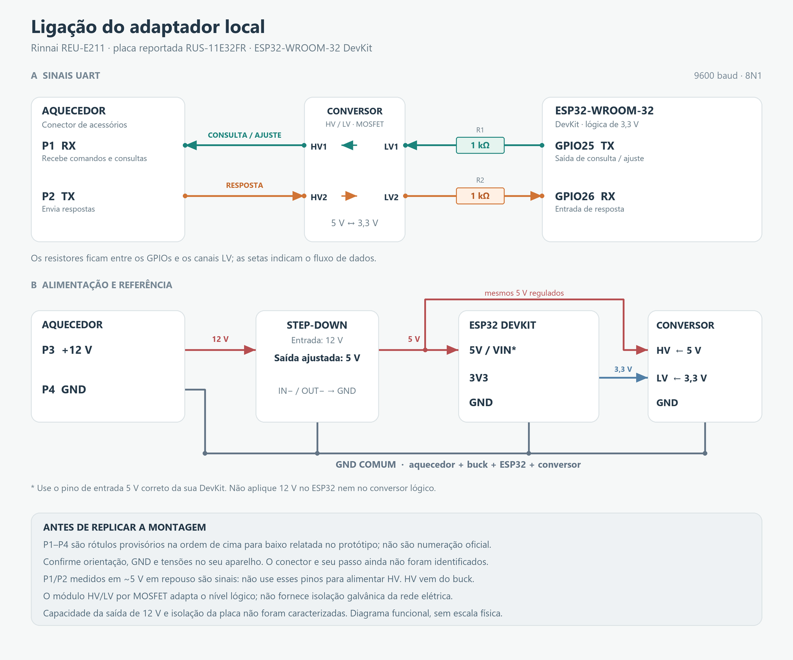

# Hardware e lista de materiais

A montagem de referência usa um **ESP32-WROOM-32 DevKit**, um conversor lógico HV/LV por MOSFET e um step-down de 12 V para 5 V. As consultas e as respostas foram validadas no protótipo Rinnai **REU-E211**, com marcação de placa reportada **RUS-11E32FR**.

[Diagrama vetorial em SVG](images/wiring-diagram.svg) · [Arquitetura em PNG](images/architecture.png)

## BOM

As especificações abaixo são critérios para escolher os materiais. Fabricante, modelo exato do conversor, capacidade da alimentação e conector ainda não foram caracterizados como um produto final.

| Ref. | Qtd. | Material | Especificação / observação |
|---|---:|---|---|
| U1 | 1 | ESP32-WROOM-32 DevKit | ESP32 clássico, com GPIO25 e GPIO26 disponíveis; configuração `esp32dev`, flash de 4 MB na placa testada. C3 e S3 não são substituições diretas desta pinagem. |
| U2 | 1 | Conversor lógico bidirecional HV/LV | Módulo comum por MOSFET, de 5 V para 3,3 V, com ao menos dois canais. Usados HV1/LV1 e HV2/LV2. A família BSS138 é uma referência comum, mas o componente do módulo instalado não foi identificado. |
| U3 | 1 | Conversor DC-DC step-down | Entrada compatível com a alimentação de acessórios medida em aproximadamente 12 V; saída regulada e ajustada para **5 V**. Recomenda-se saída nominal de pelo menos **1 A**, como folga de seleção, não como consumo medido. A placa do aquecedor também precisa suportar a carga; essa capacidade não foi medida. |
| R1, R2 | 2 | Resistores em série | **1 kΩ**, um em cada canal entre GPIO e LV. Potência nominal de 1/4 W é uma escolha prática para a montagem. |
| J1 | 1 | Conector de quatro vias e terminais | Compatível com o encaixe real do aquecedor. **Família, passo e numeração oficial não identificados**; não comprar como JST ou outro padrão sem medir. |
| — | 1 conjunto | Fios para alimentação e sinal | Condutores adequados à instalação, identificados e com conexões isoladas e firmes. |
| — | 1 | Placa de montagem | Placa perfurada, bornes ou PCB própria para fixar os módulos. Protoboard e jumpers servem para bancada; o diagrama não define uma montagem mecânica final. |
| — | 1 | Caixa / suporte | Deve fixar a eletrônica e impedir contato acidental com partes energizadas, calor e água. Escolher conforme o espaço e as condições do local. |
| — | 1 | Cabo USB de dados | Gravação inicial e bancada. O funcionamento normal utiliza alimentação pelo step-down e atualizações via Wi-Fi. |
| — | conforme montagem | Termorretrátil, espaçadores e fixadores | Isolação e alívio de esforço dos cabos. |

**Instrumentação:** multímetro para conferir polaridade e tensões. Osciloscópio ou analisador lógico ajuda em outra revisão de placa, falhas de comunicação ou adaptação do circuito.

Não há orçamento em R$ nesta BOM: preços, estoque e modelos de módulos variam. A lista descreve o que foi usado e o que ainda precisa ser confirmado ao replicar.

## Pinos do conector do aquecedor

**P1 a P4 são rótulos provisórios deste projeto**, na ordem de cima para baixo relatada na montagem original. Não há foto que fixe a orientação de observação, nem identificação da numeração pelo fabricante. Não reproduza a ordem apenas olhando o desenho: confirme o conector no aparelho.

| Rótulo do projeto | Medição DC em repouso, relativa a GND | Função no protótipo | Ligação |
|---|---:|---|---|
| P1 | aproximadamente 5 V | **RX do aquecedor** — recebe a consulta do ESP | HV1 |
| P2 | aproximadamente 5 V | **TX do aquecedor** — envia a resposta ao ESP | HV2 |
| P3 | aproximadamente 12 V | Alimentação de acessórios usada no protótipo | Entrada positiva do step-down |
| P4 | 0 V | Referência GND identificada na montagem | GND comum e entrada negativa do step-down |

A leitura DC de aproximadamente 5 V em P1/P2 não identifica sozinha TX/RX, amplitude dos pulsos ou topologia do driver. A direção foi confirmada pelo envio de consultas e recebimento de respostas válidas. **P1 e P2 são sinais, não fontes para alimentar HV.**

## Ligações de sinal

| Origem | Caminho | Destino |
|---|---|---|
| ESP32 GPIO25, TX | R1 de 1 kΩ → LV1 → canal 1 do conversor → HV1 | P1, RX do aquecedor |
| P2, TX do aquecedor | HV2 → canal 2 do conversor → LV2 → R2 de 1 kΩ | ESP32 GPIO26, RX |

- UART de **9600 baud, 8 bits, sem paridade, 1 stop bit**.
- Os resistores ficam em série no lado **LV**, não no GND.
- No firmware deste projeto, GPIO25 transmite temporariamente em **open-drain** e volta a ser entrada ao terminar o quadro. Não tratar o circuito como uma UART push-pull genérica sem revisar essa escolha.
- O uso de um módulo com inscrição HV/LV não confirma sua topologia ou limite de velocidade. O módulo MOSFET da montagem funcionou nesta ligação e nesta taxa; outros conversores exigem nova verificação.

## Ligações de alimentação

| Origem | Destino |
|---|---|
| P3, aproximadamente 12 V | Step-down IN+ |
| P4, GND | Step-down IN− |
| Step-down OUT+, ajustado para 5 V | Entrada **5V/VIN correta da DevKit** e pino **HV** do conversor lógico |
| ESP32 **3V3** | Pino **LV** do conversor lógico |
| P4 + step-down IN−/OUT− + ESP32 GND + conversor GND | Referência **GND comum** |

A inscrição e a faixa permitida de VIN variam entre DevKits. Nesta montagem, o ESP é alimentado por **5 V**; não é uma autorização para aplicar 12 V em qualquer pino VIN. Nunca aplicar 5 V diretamente em GPIO de 3,3 V.

Ajuste e meça os 5 V do buck antes de conectá-lo ao ESP. Evite alimentar ao mesmo tempo pela USB e pelo buck sem conferir como a sua placa lida com retorno de corrente na alimentação USB.

## Limites do desenho

- É um **diagrama funcional**, não um desenho de PCB, layout mecânico ou orientação de encaixe.
- A capacidade de corrente da saída de acessórios de 12 V não foi medida.
- O conversor lógico MOSFET e o buck comum **não fornecem isolação galvânica**.
- A isolação da placa do aquecedor em relação à rede elétrica não foi verificada. GND lógico não implica terra de proteção nem ponto seguro para conectar instrumentos aterrados.
- O projeto mantém o controle e as proteções originais do aquecedor. Não modifica circuito de gás, ignição ou dispositivos de segurança.
- O aquecedor possui partes conectadas à rede elétrica e trabalha com gás. A montagem deve ser feita por pessoa apta a reconhecer esses riscos, com o aparelho desenergizado durante alterações de fiação.
